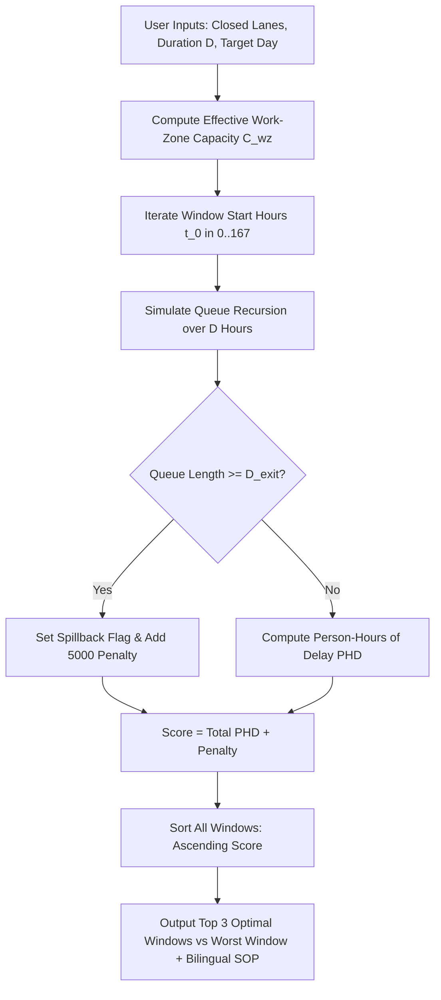

# Intelligent Traffic Decision Support System (IT-DSS)
## Mathematical Physics & Algorithm Engineering Manual (`ALGORITHMS.md`)

---

## 1. Mathematical Foundations & Homogenization

Mixed urban and highway traffic in developing metropolitan areas (e.g., Cairo, Giza, Alexandria) consists of heterogeneous vehicle categories with widely disparate dimensions, acceleration capabilities, and human occupancy levels. IT-DSS homogenizes this traffic stream into two governing metrics:
1. **Passenger Car Equivalents (PCE Flow - $q_{\text{PCE}}$ in pc/h)**: Reflects physical road occupancy and lane capacity consumption.
2. **Human Passenger Flow ($P_{\text{pax}}$ in persons/h)**: Reflects total people throughput, preventing optimization bias toward private passenger cars at the expense of high-occupancy public transit and microbuses.

### 1.1 Vehicle Classification & Equivalency Vectors

Every corridor lane $i \in \{1, 2, 3, 4\}$ is evaluated across 5 vehicle classes:

| Vehicle Class ($k$) | Description & Role | PCE Weight ($w_k$) | Average Human Occupancy ($O_k$) |
| :--- | :--- | :---: | :---: |
| **1. Private Car** | Sedans, SUVs, Ride-sharing | **1.0** | **1.4 persons** |
| **2. Microbus** | 14-Seat High-Frequency Transit | **1.5** | **14.0 persons** |
| **3. Transit Bus** | Municipal / Private Transit Bus | **2.0** | **45.0 persons** |
| **4. Heavy Freight Truck** | Multi-Axle Freight, Dump Trucks | **2.5** | **1.2 persons** |
| **5. Motorcycle** | Delivery Scooters, Motorbikes | **0.4** | **1.2 persons** |

### 1.2 Homogenization Calculus

For any given hour $h$ and lane $i$:

$$q_{\text{PCE}, i} = N_{\text{car}, i}(1.0) + N_{\text{microbus}, i}(1.5) + N_{\text{bus}, i}(2.0) + N_{\text{truck}, i}(2.5) + N_{\text{moto}, i}(0.4)$$

$$P_{\text{pax}, i} = N_{\text{car}, i}(1.4) + N_{\text{microbus}, i}(14.0) + N_{\text{bus}, i}(45.0) + N_{\text{truck}, i}(1.2) + N_{\text{moto}, i}(1.2)$$

### 1.3 Heavy Vehicle Proportion & Adjustment Factor ($f_{\text{HV}}$)

Heavy vehicles (trucks and buses) accelerate slower and occupy larger headways.
Let total vehicular count be $N_{\text{total}} = \sum_{k=1}^5 N_k$.
The proportion of heavy vehicles $P_{\text{HV}}$ is:

$$P_{\text{HV}} = \frac{N_{\text{bus}} + N_{\text{truck}}}{\max(1, N_{\text{total}})}$$

Under Highway Capacity Manual (HCM) standards for urban arterials with rolling/level terrain, the heavy vehicle passenger car equivalency factor is $E_{\text{HV}} = 2.5$. The heavy vehicle capacity adjustment factor $f_{\text{HV}}$ is:

$$f_{\text{HV}} = \frac{1.0}{1.0 + P_{\text{HV}} \times (E_{\text{HV}} - 1.0)} = \frac{1.0}{1.0 + 1.5 \times P_{\text{HV}}}$$

---

## 2. Module 1: Work-Zone Optimization & Queue Dynamics Engine

Module 1 identifies the optimal maintenance window that minimizes network delay while preventing exit spillback.



### 2.1 Effective Work-Zone Capacity Formulation

On a corridor with $N=4$ base lanes and base capacity $C_{\text{base}} = 2,000\text{ PCE/h/lane}$ ($8,000\text{ PCE/h}$ total), closing $n_{\text{closed}}$ lanes yields open lanes $n_{\text{open}} = 4 - n_{\text{closed}}$.

Effective capacity is governed by the number of lanes that remain open, with
one merge/weaving factor and a small median-lane penalty:

$$C_{\text{wz}} = 2000 \times n_{\text{open}} \times f_{\text{merge}} \times f_{\text{lane}}$$

#### 1. Merge Turbulence Friction Factor ($f_{\text{merge}}$):
Each additional closed lane adds a 6% merge/weaving loss:
$$f_{\text{merge}} = \max\left(0.40, 1.0 - 0.06 \times n_{\text{closed}}\right)$$

This gives about 1,880 PCE/h/lane with 3 of 4 lanes open and about
1,640 PCE/h/lane with one lane open. Closing lane 1 therefore leaves
$2000 \times 3 \times 0.94 = 5{,}640$ PCE/h.

#### 2. Lane-Position Factor ($f_{\text{lane}}$):
HCM does not calibrate a separate lane-position penalty. Closing a median lane
(Lane 2 or Lane 3) creates two-sided weaving, so a 2% engineering penalty is
retained; the standard rightmost-lane closure has no extra penalty:
$$f_{\text{lane}} = \begin{cases} 0.98 & \text{if lane 2 or lane 3 is closed} \\ 1.00 & \text{otherwise} \end{cases}$$

#### 3. Heavy-Vehicle Factor ($f_{\text{HV}}$):
$$f_{\text{HV}} = \frac{1}{1 + P_{\text{HV}} \times (2.5 - 1.0)}$$
It is reported for transparency but **not applied again**, because the demand
curve is already expressed in PCE/h and includes the heavy-vehicle mix.

### 2.2 Storage-Bounded Queue & Delay Recursion

Given candidate start hour $t_0$, duration $D$ hours, and the physical distance
$D_{\text{exit}}$ from the taper to the previous upstream exit, the engine
converts PCE flow to physical vehicles with the same fleet mix used by the
canvases:

$$\overline{\text{PCE}} = 1.125 + 1.3 \times P_{\text{HV}}, \qquad Q_{\text{veh}} = \frac{Q_{\text{PCE}}}{\overline{\text{PCE}}}, \qquad C_{\text{veh}} = \frac{C_{\text{wz}}}{\overline{\text{PCE}}}$$

The upstream storage can hold at most
$N_{\text{store}} = D_{\text{exit}} \times n_{\text{open}} / 6.5$ vehicles
(6.5 m stopped spacing). A queue cannot grow past that storage: once it is
full, excess demand is metered or diverted at the upstream exit instead of
joining the queue. This is why the reported queue is capped at $D_{\text{exit}}$
and never reaches hundreds of kilometres.

For each hour $t \in [t_0, t_0 + D)$:

1. **Queue carry-over with storage cap:**
   $$Q(t) = \min\left(N_{\text{store}}, \max\left(0.0, Q(t-1) + Q_{\text{veh}}(t) - C_{\text{veh}}\right)\right)$$
   The engine integrates the exact triangular queue trajectory during the hour,
   giving vehicle-hours in queue $VH(t)$ and the number of vehicles that
   actually joined the queue, $J(t)$.

2. **Physical queue length:**
   $$L_{\text{queue}}(t) = \min\left(D_{\text{exit}}, \frac{Q(t) \times 6.5}{n_{\text{open}}}\right)$$

3. **Spillback flag:**
   $$\text{Spillback}(t) = \left(Q(t) \ge 0.95 N_{\text{store}}\right) \lor \left(L_{\text{queue}}(t) \ge 0.95 D_{\text{exit}}\right)$$

4. **Average delay per joining vehicle:**
   Little's law converts vehicle-hours in queue to delay, plus the geometric
   work-zone and merge penalty:
   $$d_{\text{queue}}(t) = \frac{VH(t)}{J(t)} \times 3600$$
   $$d_{\text{base}} = \left(\frac{L_{\text{wz}}}{V_{\text{wz}}} - \frac{L_{\text{wz}}}{V_{\text{posted}}}\right) \times 3600 + \left(3.0 \text{ if } n_{\text{open}} < 4 \text{ else } 0\right)$$
   $$d_{\text{wz}}(t) = \min\left(600, d_{\text{queue}}(t) + d_{\text{base}}\right)$$

5. **Person-hours of delay:**
   $$\text{PHD}(t) = \left(VH(t) + d_{\text{base}} \times \frac{J(t)}{3600}\right) \times \frac{P_{\text{pax}}(t)}{Q_{\text{veh}}(t)}$$

### 2.3 Optimization Search Algorithm (Pseudocode)

The optimizer is evaluated at two scopes: the selected day (24 candidate start
hours) and the full 7-day week (168 candidate start hours). Every candidate uses
the same contiguous-window queue recursion, with demand, passenger occupancy,
and heavy-vehicle capacity adjustments rolling across midnight and day
boundaries. A `target_start_hour` supplied by the operations room is evaluated
separately as a what-if window (`rank = 0`) without changing the ranking.

```python
def optimize_workzone_schedule(request, hourly_pce, hourly_pax, hourly_hv,
                               speed_limit, D_exit):
    n_closed = len(request.closed_lanes)
    open_lanes = max(1, 4 - n_closed)
    C_wz, f_merge, f_lane, f_hv = compute_workzone_capacity(
        2000.0, 4, request.closed_lanes, mean(hourly_hv)
    )
    N_store = D_exit * open_lanes / 6.5

    def score_window(start_h):
        queue = 0.0
        total_phd = 0.0
        max_queue_m = 0.0
        spill = False
        for step in range(request.duration_hours):
            h = (start_h + step) % 24
            avg_pce = 1.125 + 1.3 * hourly_hv[h]
            demand_veh = hourly_pce[h] / avg_pce
            cap_veh = C_wz / avg_pce
            queue, vehicle_hours, joining = storage_queue_step(
                queue, demand_veh, cap_veh, N_store
            )
            queue_m = min(D_exit, queue * 6.5 / open_lanes)
            spill |= queue_m >= 0.95 * D_exit
            base_delay = geometric_delay(speed_limit, open_lanes)
            delay = min(600.0, vehicle_hours / max(1e-6, joining) * 3600.0 + base_delay)
            pax_per_veh = hourly_pax[h] / max(1e-6, demand_veh)
            total_phd += (vehicle_hours + base_delay * joining / 3600.0) * pax_per_veh
            max_queue_m = max(max_queue_m, queue_m)
        penalty = 5000.0 if spill else 0.0
        return (total_phd + penalty, start_h, total_phd, max_queue_m, spill)

    daily = sorted(score_window(h) for h in range(24))
    weekly = sorted(score_window_weekly(d, h) for d in range(7) for h in range(24))
    requested = score_window(request.target_start_hour) if request.target_start_hour is not None else None

    # SOP geometry (MUTCD): taper grows with speed and number of closed lanes.
    L_taper = round(0.62 * 3.65 * speed_limit * n_closed, 1)
    L_buffer = round(2.5 * speed_limit, 1)
    speed_wz = max(40.0, speed_limit - 20.0)
    return daily[:3], daily[-1], weekly[:3], weekly[-1], requested, L_taper, L_buffer, speed_wz
```

---

## 3. Module 2: 4-Way Intersection Simulator Engine

Module 2 compares 4 geometric alternatives under identical demand vectors:
$Q_{\text{main}} \in [500, 7000]$ veh/h, $Q_{\text{cross}} \in [100, 3500]$ veh/h, turning proportion $P_{\text{turn}} \in [5\%, 45\%]$, heavy vehicle proportion $P_{\text{HV}} \in [2\%, 40\%]$, and protected U-turn median distance $D_{\text{uturn}} \in [150, 1000]\text{ m}$.

Total approaching flow is $Q_{\text{total}} = Q_{\text{main}} + Q_{\text{cross}}$.

```mermaid
graph TD
    Inputs[Inputs: Main Flow, Cross Flow, Turning %, Heavy %, U-Turn Dist] --> Open[Alt 1: Uncontrolled Open]
    Inputs --> Signal[Alt 2: Webster 4-Phase Signal]
    Inputs --> UTurn[Alt 3: Protected U-Turn Corridor]
    Inputs --> Round[Alt 4: Modern 3-Lane Roundabout]

    Open --> CalcOpen[Conflict Pts: 32 | Delay d_open | Queue Q95_open]
    Signal --> CalcSig[Conflict Pts: 8 | Webster Delay d_sig | Queue Q95_sig]
    UTurn --> CalcUTurn[Conflict Pts: 4 | Weaving Delay d_uturn | Queue Q95_uturn]
    Round --> CalcRound[Conflict Pts: 8 | Roundabout Delay d_round | Queue Q95_round]

    CalcOpen & CalcSig & CalcUTurn & CalcRound --> DecisionMatrix[4-Way Performance Matrix & LoS Grading]
    DecisionMatrix --> Recommender{Flow & Safety Recommender}
    Recommender -->|Q_main >= 2800| RecommendUTurn[Recommend Protected U-Turn Corridor]
    Recommender -->|Q_total < 2200 and balanced| RecommendRound[Recommend Modern Roundabout]
    Recommender -->|Otherwise| CompareDelays[Pick Min Delay Signal vs UTurn]
```

### 3.1 Alternative 1: Uncontrolled Open Intersection
* **Conflict Points:** **32** (16 crossing, 8 merging, 8 diverging). Highest fatal collision hazard.
* **Gap-acceptance capacity** (8 approach lanes, 900 veh/h/lane):
  $$C_{\text{open}} = 900 \times 8 \times \max(0.80, 1 - 0.2 P_{\text{turn}}) \times \max(0.75, 1 - 0.25 P_{\text{HV}})$$
* **Average delay per vehicle:**
  $$d_{\text{open}} = 9.5 + d_{\text{inc}}(C_{\text{open}}, X_{\text{open}}), \quad X_{\text{open}} = \frac{Q_{\text{total}}}{C_{\text{open}}}$$
  where the HCM incremental delay term is
  $$d_{\text{inc}}(C, X) = 900 T \left[(X-1) + \sqrt{(X-1)^2 + \frac{8 k i X}{C T}}\right], \quad T=0.25\text{ h}, k=0.5, i=1.0$$
* **95th-percentile queue:**
  $$q_{\text{veh}} = 1.6 \frac{Q_{\text{total}}}{3600} d_{\text{open}} + \max(0, Q_{\text{total}} - C_{\text{open}}) T$$
  $$Q95_{\text{open}} = \min\left(500, \max\left(15, \frac{q_{\text{veh}}}{2} \times 7.5\right)\right)\text{ m}$$
  (7.5 m per queued vehicle, two mainline lanes). Delay is capped at 300 s and
  the LOS uses the unsignalized thresholds.

### 3.2 Alternative 2: Adaptive 4-Phase Traffic Signal (Webster's Model)
* **Conflict Points:** **8** (Direct right-angle crossings eliminated).
* **Lane group saturation flows** (2 main lanes/direction, 2 cross lanes/direction):
  $$S_{\text{main}} = 1900 \times 2 \times f_{\text{HV}} \times f_{\text{turn}}, \quad S_{\text{cross}} = 1800 \times 2 \times f_{\text{HV}} \times f_{\text{turn}}$$
  $$f_{\text{HV}} = \max(0.70, 1 - 0.5 P_{\text{HV}}), \quad f_{\text{turn}} = \max(0.80, 1 - 0.2 P_{\text{turn}})$$
* **Critical flow ratios** use the 55/45 directional split on each two-way input:
  $$y_{\text{main}} = \frac{0.55 Q_{\text{main}}}{S_{\text{main}}}, \quad y_{\text{cross}} = \frac{0.55 Q_{\text{cross}}}{S_{\text{cross}}}, \quad Y = \min(0.95, \max(0.02, y_{\text{main}} + y_{\text{cross}}))$$
* **Lost time:** $L = 16$ s (two 4 s yellows + two 4 s all-reds).
* **Webster cycle:** $C_{\text{raw}} = (1.5L + 5)/(1-Y)$, clamped to 45–160 s.
* **Green splits** between the critical movements:
  $$G_{\text{eff}} = \max(16, C - L), \quad G_{\text{main}} = \max\left(8, G_{\text{eff}} \frac{y_{\text{main}}}{Y}\right), \quad G_{\text{cross}} = \max(8, G_{\text{eff}} - G_{\text{main}})$$
  $$C = G_{\text{main}} + G_{\text{cross}} + L$$
* **Capacities and degree of saturation:**
  $$C_{\text{main}} = 2 S_{\text{main}} \frac{G_{\text{main}}}{C}, \quad C_{\text{cross}} = 2 S_{\text{cross}} \frac{G_{\text{cross}}}{C}, \quad X = \max\left(\frac{Q_{\text{main}}}{C_{\text{main}}}, \frac{Q_{\text{cross}}}{C_{\text{cross}}}\right)$$
* **HCM control delay** for each approach, then flow-weighted:
  $$d_1 = \frac{0.5 C (1 - g/C)^2}{1 - \min(0.98, X) g/C}, \quad d_2 = d_{\text{inc}}(C_{\text{approach}}, X)$$
  $$d_{\text{sig}} = \frac{Q_{\text{main}}(d_{1,\text{main}} + d_{2,\text{main}}) + Q_{\text{cross}}(d_{1,\text{cross}} + d_{2,\text{cross}})}{Q_{\text{total}}}$$
* **95th-percentile queue:**
  $$q_{\text{main}} = 1.5 \frac{0.55 Q_{\text{main}}}{3600}(C-G_{\text{main}}) + \max(0, Q_{\text{main}} - C_{\text{main}})T$$
  $$q_{\text{cross}} = 1.5 \frac{0.55 Q_{\text{cross}}}{3600}(C-G_{\text{cross}}) + \max(0, Q_{\text{cross}} - C_{\text{cross}})T$$
  $$Q95_{\text{sig}} = \min\left(500, \max\left(15, \frac{q_{\text{main}}}{2} 7.5, \frac{q_{\text{cross}}}{2} 7.5\right)\right)$$

### 3.3 Alternative 3: Closed Median + Protected U-Turn Corridor (Egyptian Axis Model)
Median is permanently closed with concrete jersey barriers; cross and turning traffic turn right and execute a protected U-turn upstream.
* **Conflict Points:** **4** (Merging/diverging only, zero crossing points).
* **Capacity:** four mainline lanes plus a protected U-turn opening:
  $$C_{\text{mainline}} = 4 \times 1900 \times f_{\text{HV}}, \quad C_{\text{uturn}} = C_{\text{mainline}} + 1200 f_{\text{HV}}$$
* **Diverted share and detour time** (cruise speed 50 km/h = 13.89 m/s):
  $$P_{\text{div}} = \mathrm{clamp}\left(\frac{Q_{\text{cross}} + Q_{\text{main}} P_{\text{turn}}}{Q_{\text{total}}}, 0, 1\right), \quad t_{\text{detour}} = \frac{2 D_{\text{uturn}}}{13.89}$$
* **Weaving and weighted delay:**
  $$d_{\text{weave}} = 6 + 14\left(\frac{Q_{\text{total}}}{6800}\right)^{2.1}$$
  $$d_{\text{uturn}} = P_{\text{div}}\max(0, t_{\text{detour}} - 15) + d_{\text{weave}} + d_{\text{inc}}(C_{\text{uturn}}, X_{\text{uturn}})$$
* **95th-percentile queue:**
  $$q_{\text{veh}} = 1.5 \frac{P_{\text{div}} Q_{\text{total}}}{3600} d_{\text{uturn}} + \max(0, Q_{\text{total}} - C_{\text{uturn}}) T$$
  $$Q95_{\text{uturn}} = \min\left(500, \max(12, q_{\text{veh}} \times 7.5)\right)$$

### 3.4 Alternative 4: Modern 3-Lane Roundabout
* **Conflict Points:** **8** (Entering/circulating merge points).
* **Circulating volume and HCM entry capacity** (8 entry lanes):
  $$Q_{\text{circ}} = 0.45 Q_{\text{main}} + 0.55 Q_{\text{cross}}(1 + P_{\text{turn}}), \quad Q_{\text{entry}} = Q_{\text{circ}}/4$$
  $$C_{\text{entry}} = 1130 e^{-0.0007 Q_{\text{entry}}} \max(0.70, 1 - 0.5 P_{\text{HV}}), \quad C_{\text{round}} = 8 C_{\text{entry}}$$
* **Average delay and queue:**
  $$X_{\text{round}} = \frac{Q_{\text{total}}}{C_{\text{round}}}, \quad d_{\text{round}} = \frac{3600}{C_{\text{entry}}} + 5 + d_{\text{inc}}(C_{\text{round}}, X_{\text{round}})$$
  $$q_{\text{veh}} = 1.6 \frac{Q_{\text{total}}}{3600} d_{\text{round}} + \max(0, Q_{\text{total}} - C_{\text{round}})T$$
  $$Q95_{\text{round}} = \min\left(500, \max\left(18, \frac{q_{\text{veh}}}{2} 7.5\right)\right)$$
  The LOS uses the unsignalized thresholds, and both queue and delay are
  capped exactly as in the API response (500 m and 300 s).

### 3.5 Level of Service and Winner Scoring
HCM delay thresholds are control-specific, and $v/c > 1$ is always LoS F:

| Delay (s/veh) | Signalized | Unsignalized / roundabout |
| :--- | :--- | :--- |
| ≤ 10 | A | A |
| ≤ 15 | B | B |
| ≤ 20 | B | C |
| ≤ 25 | C | C |
| ≤ 35 | C | D |
| ≤ 50 | D | E |
| ≤ 55 | D | F |
| ≤ 80 | E | F |
| > 80 | F | F |

The recommended alternative minimizes
$$\text{score} = d + 80[\text{OPEN and } Q_{\text{total}} > 4000] + 60[v/c > 1] + 30[\text{spillback}] + 0.08(100 - \text{safety index})$$
so an uncontrolled 32-conflict junction cannot win on delay arithmetic alone
once its demand leaves the HCM signal-warrant range.

---

## 4. Module 3: Incident Hydrodynamics & Shockwave Propagation

Based on the **Lighthill-Whitham-Richards (LWR)** hydrodynamic theory of traffic flow, which treats vehicular streams as a compressible fluid governed by the continuity equation:

$$\frac{\partial k}{\partial t} + \frac{\partial q}{\partial x} = 0$$

When a sudden bottleneck occurs, a shockwave boundary forms separating State 1 (incoming flow) and State 2 (bottleneck capacity).

```text
               <=== Backward Shockwave Propagation Speed w (km/h) ===
--------------------------------------------------------------------------------
State 1: Upstream Inflow                      State 2: Bottleneck Restriction
q1 = Incoming Flow (PCE/h)                   q2 = Residual Discharge Capacity
v1 = Upstream Speed (km/h)                   Blocked Lanes = 1..3
k1 = q1 / v1 (veh/km)                        Micro-friction weaving penalty
--------------------------------------------------------------------------------
Distance to Upstream Interchange Exit: D_exit (m)
Countdown Until Upstream Exit Blocked: T_block = (D_exit / w) * 60 minutes
```

### 4.1 State 1 (Upstream Arrival)
$$q_1 = Q_{\text{arrival}}\text{ (PCE/h)}, \quad v_1 = \min(120, \max(15, V_{\text{speed}}))\text{ km/h}$$
$$k_{1,\text{veh}} = \frac{q_1}{v_1\,\overline{\text{PCE}}}\text{ veh/km}, \quad k_{1,\text{PCE}} = k_{1,\text{veh}}\,\overline{\text{PCE}}\text{ PCE/km}$$

### 4.2 State 2 (Bottleneck Discharge)
Given $n_{\text{blocked}}$ lanes blocked out of 4:
* **Micro-friction weaving penalty:**
  $$\mu_{\text{micro}} = \max(0.68, 1 - 0.32 W_{\text{idx}}), \quad W_{\text{idx}} \in [0,1]$$
* **Incident severity factor:**
  $$\gamma_{\text{type}} = \{ \text{STALL}: 0.95,\ \text{COLLISION}: 0.88,\ \text{MICROBUS\_STOP}: 0.78,\ \text{default}: 0.90 \}$$
* **Bottleneck discharge capacity (PCE/h):**
  $$q_2 = 2000 \times (4 - n_{\text{blocked}}) \times \mu_{\text{micro}} \times \gamma_{\text{type}}$$

### 4.3 LWR Backward Propagation Velocity ($w$)
Jam density follows the 6.5 m stopped spacing used everywhere else:
$$k_{\text{jam,veh}} = \frac{1000}{6.5} \times 4 = 615.4\text{ veh/km}, \quad k_{\text{jam,PCE}} = k_{\text{jam,veh}}\,\overline{\text{PCE}}$$
If $q_1 > q_2$:
$$w = \min\left(25, \frac{q_1 - q_2}{\max(10^{-6}, k_{\text{jam,PCE}} - \min(k_{1,\text{PCE}}, 0.95 k_{\text{jam,PCE}}))}\right)\text{ km/h}$$
Otherwise $w=0$. The 25 km/h cap reflects observed urban shockwave speeds.

### 4.4 Upstream Exit Blockage Countdown ($T_{\text{block}}$)
$$T_{\text{block}} = \begin{cases}
\min\left(240, \frac{D_{\text{exit}}/1000}{w} \times 60\right)\text{ min} & w > 0.05 \\
999\text{ min (no blockage)} & w \le 0.05
\end{cases}$$
A countdown at or below 20 min triggers the red spillback alert.

### 4.5 60-Minute Discrete Progression Timeline
Computed every 5 minutes for $t \in [0, 5, \dots, 60]$:
* **Shockwave front:** $L(t) = \min\left(D_{\text{exit}}, w \times \frac{t}{60} \times 1000\right)$ m.
* **Queued vehicles:** the minimum of excess demand, geometric storage, and physical capacity:
  $$N_{\text{veh}}(t) = \min\left(\frac{D_{\text{exit}}}{6.5}4,\ \frac{q_1-q_2}{\overline{\text{PCE}}}\frac{t}{60},\ \frac{L(t)}{6.5}4\right)$$
* **Upstream speed:**
  $$V(t) = \max\left(10, v_1 - \frac{L(t)}{D_{\text{exit}}}(v_1 - 10)\right)\text{ km/h}$$
* **Spillback reached:** $L(t) \ge D_{\text{exit}} - 0.5$ m.

---

## 5. Module 4: Dynamic Reversible Lanes & Green Wave Optimizer

### 5.1 Directional Surge Calculus
Given inbound demand $Q_{\text{in}}$ and outbound demand $Q_{\text{out}}$:
$$\text{Directional Split: } \text{Split}_{\text{in}} = \left(\frac{Q_{\text{in}}}{\max(1, Q_{\text{in}} + Q_{\text{out}})}\right) \times 100.0\%$$

* **Configuration Capacities:**
  * **Standard 4+4:** $C_{\text{in}} = 7,200\text{ PCE/h}$, $C_{\text{out}} = 7,200\text{ PCE/h}$.
  * **Reversible 5+3:** $C_{\text{in, rev}} = 8,850\text{ PCE/h}$, $C_{\text{out, rev}} = 5,250\text{ PCE/h}$.
* **Warrant criteria:**
  $$\text{viable} = \frac{Q_{\text{out}}}{5250} < 0.85$$
  (the inbound capacity always rises from 7,200 to 8,850 PCE/h, so the
  binding constraint is the outbound direction that loses a lane).
  $$\text{recommend 5+3} = \left(\text{Split}_{\text{in}} > 68\% \land \frac{Q_{\text{out}}}{7200} < 0.45 \land \text{viable}\right) \lor \left(\text{EmergencyMode} \land \text{viable}\right)$$
  The outbound test uses the **standard 4+4** capacity (7,200 PCE/h), so the
  opposite direction retains headroom before a lane is taken away.

### 5.2 Speed, Travel Time, and Delay
For configuration $k$, with 75 km/h free-flow speed:
$$v/c_{\text{in}} = \frac{Q_{\text{in}}}{C_{\text{in}}(k)}$$
$$V_{\text{speed}}(k) = \max\left(v_{\min}, 75 \left(1 - 0.75 \max(0, v/c_{\text{in}} - 0.65)\right)\right)\text{ km/h}$$
where $v_{\min}=12$ km/h for 4+4 and $15$ km/h for 5+3. Then
$$t_{\text{travel}}(k) = \frac{D_{\text{corridor}}}{V_{\text{speed}}(k)} \times 60\text{ min}, \quad t_{\text{free}} = \frac{D_{\text{corridor}}}{75} \times 60\text{ min}$$
$$\text{delay}(k) = \min\left(600, \max(0, t_{\text{travel}}(k) - t_{\text{free}}) \times 60\right)\text{ s/veh}$$
Both reported savings are derived from these same travel times:
$$\Delta t_{\%} = \max\left(0, \frac{t_{\text{travel}}(\text{Std}) - t_{\text{travel}}(\text{Rev})}{t_{\text{travel}}(\text{Std})} 100\right)$$
$$\Delta d_{\%} = \max\left(0, \frac{\text{delay}(\text{Std}) - \text{delay}(\text{Rev})}{\text{delay}(\text{Std})} 100\right)$$

### 5.3 Green Wave Signal Progression Offsets
Synchronizes $N \in [1, 10]$ signalized nodes along the actual corridor at
$V_{\text{prog}} = 60$ km/h = 16.67 m/s. Link spacing comes from the corridor
geometry, not a fixed constant:
$$D_{\text{link}} = \frac{D_{\text{corridor}} \times 1000}{N}$$
* **Cycle length:** 90 s; **green window:** 52 s.
* **Distance of node $k$:** $D_k = (k-1)D_{\text{link}}$, with $D_1 = 0$.
* **Offset:**
  $$\Delta t_{\text{offset},k} = \left(\frac{D_k}{16.67}\right) \bmod 90\text{ s}$$
  For the 8.5 km, 5-node default corridor this gives 1,700 m spacing and
  offsets of 0, 12, 24, 36, and 48 s (not the old 450 m/10.8 s spacing).

### 5.4 Emergency / VIP Pre-Arrival Queue Flush Lead Time
Little's law converts the baseline delay into vehicles in the approach, then
into a physical queue over four inbound lanes (7.5 m/veh):
$$N_{\text{queue}} = \frac{Q_{\text{in}}}{3600}\,\text{delay}_{\text{std}}, \quad L_{\text{queue}} = \min\left(0.90 D_{\text{corridor}} \times 1000, \max\left(0, \frac{N_{\text{queue}} \times 7.5}{4}\right)\right)\text{ m}$$
$$T_{\text{flush}} = \begin{cases} 0 & L_{\text{queue}} < 1\text{ m} \\ \min\left(240, \frac{L_{\text{queue}}}{8.5} + 18\right)\text{ s} & \text{otherwise} \end{cases}$$

---

## 6. Microscopic Canvas Simulation Physics (60fps)

Both canvases are deterministic browser-side microsimulations. They are not
SUMO renders. Arrivals are seeded Poisson processes, every class has its own
physical length, acceleration, deceleration, gap, and headway, and every
published KPI is measured from the simulated vehicles. During network warm-up
the UI shows `—` instead of a fabricated fallback.

### 6.1 Intelligent Driver Model (IDM) Car-Following
For each vehicle class $c$, with desired speed $v_0$, gap $s$, and speed
difference $\Delta v = v - v_{\text{leader}}$:
$$a(t) = a_c \left[1 - \left(\frac{v}{v_0}\right)^4 - \left(\frac{s^*}{s}\right)^2\right]$$
$$s^* = s_{0,c} + v\,T_c\,h + \frac{v\,\Delta v}{2\sqrt{a_c b_c}}$$
where $h$ is an optional headway scale. The work-zone canvas uses
$h=0.25$ below 5 m/s inside the queue so jam density matches the 6.5 m
stopped spacing; otherwise $h=1$. Class parameters include:

| Class | PCE | Length | $a$ (m/s²) | $b$ (m/s²) | $s_0$ (m) | $T$ (s) |
| :--- | :--- | :--- | :--- | :--- | :--- | :--- |
| Car | 1.0 | 4.6 m | 2.6 | 4.2 | 2.0 | 1.15 |
| Microbus | 1.5 | 5.5 m | 2.2 | 4.0 | 1.8 | 1.25 |
| Bus | 2.0 | 12.0 m | 1.3 | 3.4 | 2.5 | 1.70 |
| Truck | 2.5 | 14.0 m | 1.05 | 3.1 | 3.0 | 1.90 |

Acceleration is clamped to $[-1.5b_c, a_c]$. The fleet mix is 25%
microbuses, the remaining share split between buses and trucks by the heavy
percentage, and $f_{\text{HV}}$ is already represented by the PCE-weighted
arrival rate.

### 6.2 Work-Zone Canvas: Merge, Storage, and Capacity Metering
* **Geometry:** coordinates are metres. The approach is 600 m, the taper is
  defined by the analytical taper length, and `storageM` is the corridor's
  actual upstream-exit distance.
* **Global upstream storage:** before inserting a vehicle, the rearmost
  vehicle in any lane must still be upstream of $-D_{\text{exit}}+5$ m.
  Otherwise the arrival is metered/diverted at the upstream exit. This caps the
  physical queue at the corridor storage instead of letting it grow forever.
* **Mandatory merge:** a vehicle whose preferred lane is closed starts looking
  for a gap 150 m before the taper. Only about 18% of affected vehicles remain
  in the closed lane until the nose; the rest merge early.
* **Nose fallback:** a boxed-in closed-lane vehicle may be placed into a valid
  adjacent slot if the required courtesy shift is at most 16 m; otherwise it
  stops at the barrier. This removes the old closed-lane deadlock without
  teleporting a queue.
* **Capacity meter:** each open lane has its own discharge meter at the taper.
  The mean discharge headway is
  $$h_{\text{lane}} = \frac{n_{\text{open}}}{C_{\text{wz,veh/s}}}, \quad h_{\text{veh}} = h_{\text{lane}}\frac{\text{PCE}_{\text{veh}}}{\overline{\text{PCE}}}$$
  A vehicle at the stop line is released at its scheduled slot. This reproduces
  the analytical PCE capacity instead of under-discharging because IDM has to
  accelerate from rest. Measured throughput is counted at the taper over a
  rolling 60 s window.
* **Measured delay:** completed-trip journey time minus free-flow time,
  aggregated over completed trips in a rolling 120 s window. The canvas
  compares this measured value with the analytical planning delay and queue,
  and explains that the analytical estimate assumes a fully stopped
  6.5 m/vehicle jam queue while the IDM queue is partly moving.

### 6.3 Intersection Canvas: Signal and U-Turn Measurement
* **Signal:** the canvas uses the same Webster timing as the analytical engine
  (2 lanes/direction, 1,900/1,800 PCE/h/lane, 55% critical-direction share,
  16 s lost time, 4 s yellow + 4 s all-red). Signal KPIs are withheld until one
  full cycle and 20 completed trips, then averaged over the last two cycles so
  red-phase arrivals are not over-represented.
* **U-turn:** eastbound vehicles turn with the selected turning probability;
  side-street traffic uses the right-in/right-out loop. U-turn KPIs are withheld
  until 30 s and 20 completed trips, and measure actual journey delay versus a
  straight free-flow trip.
* **Analytical reference:** each panel displays the corresponding HCM/Webster
  planning delay and 95th-percentile queue. The measured IDM sample and the
  planning value intentionally differ because they cover different populations
  and analysis periods; the reference is shown so the screen never implies that
  one is the other.
