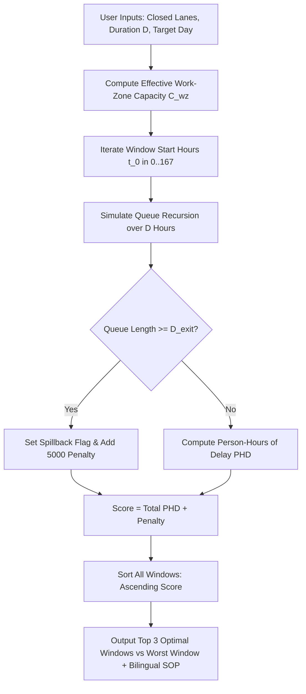

# Intelligent Traffic Decision Support System (IT-DSS)
## Mathematical Physics & Algorithm Engineering Manual (`ALGORITHMS.md`)

---

## 1. Mathematical Foundations & Homogenization

Mixed urban and highway traffic in developing metropolitan areas (e.g., Cairo, Giza, Alexandria) consists of heterogeneous vehicle categories with widely disparate dimensions, acceleration capabilities, and human occupancy levels. IT-DSS homogenizes this traffic stream into two governing metrics:
1. **Passenger Car Equivalents (PCE Flow - $q_{\text{PCE}}$ in pc/h)**: Reflects physical road occupancy and lane capacity consumption.
2. **Human Passenger Flow ($P_{\text{pax}}$ in persons/h)**: Reflects total people throughput, preventing optimization bias toward private passenger cars at the expense of high-occupancy public transit and microbuses.

### 1.1 Vehicle Classification & Equivalency Vectors

Every corridor lane $i \in \{1, 2, 3, 4\}$ is evaluated across 5 vehicle classes:

| Vehicle Class ($k$) | Description & Role | PCE Weight ($w_k$) | Average Human Occupancy ($O_k$) |
| :--- | :--- | :---: | :---: |
| **1. Private Car** | Sedans, SUVs, Ride-sharing | **1.0** | **1.4 persons** |
| **2. Microbus** | 14-Seat High-Frequency Transit | **1.5** | **14.0 persons** |
| **3. Transit Bus** | Municipal / Private Transit Bus | **2.0** | **45.0 persons** |
| **4. Heavy Freight Truck** | Multi-Axle Freight, Dump Trucks | **2.5** | **1.2 persons** |
| **5. Motorcycle** | Delivery Scooters, Motorbikes | **0.4** | **1.2 persons** |

### 1.2 Homogenization Calculus

For any given hour $h$ and lane $i$:

$$q_{\text{PCE}, i} = N_{\text{car}, i}(1.0) + N_{\text{microbus}, i}(1.5) + N_{\text{bus}, i}(2.0) + N_{\text{truck}, i}(2.5) + N_{\text{moto}, i}(0.4)$$

$$P_{\text{pax}, i} = N_{\text{car}, i}(1.4) + N_{\text{microbus}, i}(14.0) + N_{\text{bus}, i}(45.0) + N_{\text{truck}, i}(1.2) + N_{\text{moto}, i}(1.2)$$

### 1.3 Heavy Vehicle Proportion & Adjustment Factor ($f_{\text{HV}}$)

Heavy vehicles (trucks and buses) accelerate slower and occupy larger headways.
Let total vehicular count be $N_{\text{total}} = \sum_{k=1}^5 N_k$.
The proportion of heavy vehicles $P_{\text{HV}}$ is:

$$P_{\text{HV}} = \frac{N_{\text{bus}} + N_{\text{truck}}}{\max(1, N_{\text{total}})}$$

Under Highway Capacity Manual (HCM) standards for urban arterials with rolling/level terrain, the heavy vehicle passenger car equivalency factor is $E_{\text{HV}} = 2.5$. The heavy vehicle capacity adjustment factor $f_{\text{HV}}$ is:

$$f_{\text{HV}} = \frac{1.0}{1.0 + P_{\text{HV}} \times (E_{\text{HV}} - 1.0)} = \frac{1.0}{1.0 + 1.5 \times P_{\text{HV}}}$$

---

## 2. Module 1: Work-Zone Optimization & Queue Dynamics Engine

Module 1 identifies the optimal maintenance window that minimizes network delay while preventing exit spillback.



### 2.1 Effective Work-Zone Capacity Formulation

On a corridor with $N=4$ base lanes and base capacity $C_{\text{base}} = 2,000\text{ PCE/h/lane}$ ($8,000\text{ PCE/h}$ total), closing $n_{\text{closed}}$ lanes yields open lanes $n_{\text{open}} = 4 - n_{\text{closed}}$.

Effective capacity is degraded by three multiplicative friction coefficients:

$$C_{\text{wz}} = C_{\text{base}} \times (4 - n_{\text{closed}}) \times f_{\text{merge}} \times f_{\text{lane}} \times f_{\text{HV}}$$

#### 1. Merge Turbulence Friction Factor ($f_{\text{merge}}$):
Captures lateral deceleration and shockwaves caused by vehicles merging across open lanes:
$$f_{\text{merge}} = \max\left(0.40, 1.0 - 0.12 \times n_{\text{closed}}\right)$$

#### 2. Lane-Specific Closure Penalty ($f_{\text{lane}}$):
Captures the operational consequences of which specific lane is taken out of service:
* **Closing Lane 1 (Rightmost slow lane):** Heavy freight trucks, buses, and microbuses loading on the right shoulder are forced to weave leftward across middle lanes:
  $$f_{\text{lane}} = 0.88$$
* **Closing Center Lanes (Lane 2 or Lane 3):** Creates bilateral pinch points with merging turbulence from both sides:
  $$f_{\text{lane}} = 0.90$$
* **Closing Lane 4 (Leftmost fast lane):** Fast vehicles must merge right, posing high-speed rear-end risks and requiring longer deceleration tapers:
  $$f_{\text{lane}} = 0.93$$

### 2.2 Queue Accumulation & Delay Recursion

Given candidate start hour $t_0$ and duration $D$ hours:
Initialize vehicular queue $Q_{\text{queue}}(t_0 - 1) = 0.0$.

For each hour $t \in [t_0, t_0 + D)$:

1. **Vehicular Queue Carryover:**
   $$Q_{\text{queue}}(t) = \max\left(0.0, Q_{\text{queue}}(t-1) + Q_{\text{PCE}}(t) - C_{\text{wz}}\right)$$

2. **Physical Queue Length ($L_{\text{queue}}$ in meters):**
   Vehicles in the queue distribute evenly across remaining open lanes:
   $$L_{\text{queue}}(t) = \frac{Q_{\text{queue}}(t) \times 6.5\text{ m}}{4 - n_{\text{closed}}}$$
   *(where $6.5\text{ m}$ is average vehicle length plus stopped safety headway)*

3. **Spillback Threshold Check:**
   $$\text{Spillback}(t) = \left(L_{\text{queue}}(t) \ge D_{\text{upstream\_exit}}\right)$$

4. **Average Delay per Vehicle ($d_{\text{wz}}$ in seconds):**
   Combines volume-to-capacity friction with queuing delay:
   $$d_{\text{wz}}(t) = 12.0 \times \left(\frac{Q_{\text{PCE}}(t)}{\max(1, C_{\text{wz}})}\right)^3 + \left(\frac{Q_{\text{queue}}(t)}{\max(1, C_{\text{wz}})}\right) \times 1800.0$$

5. **Person-Hours of Delay ($PHD$):**
   Weighting vehicle delay by passenger occupancy:
   $$\text{PHD}(t) = \left(\frac{Q_{\text{PCE}}(t) \times d_{\text{wz}}(t)}{3600.0}\right) \times \left(\frac{P_{\text{pax}}(t)}{\max(1, Q_{\text{PCE}}(t))}\right)$$

### 2.3 Optimization Search Algorithm (Pseudocode)

```python
def optimize_workzone_schedule(request, hourly_pce, hourly_pax, hourly_hv, speed_limit, D_exit):
    n_closed = len(request.closed_lanes)
    open_lanes = max(1, 4 - n_closed)
    
    # 1. Compute effective work zone capacity
    C_wz, f_merge, f_lane, f_hv = compute_workzone_capacity(2000.0, 4, request.closed_lanes, avg(hourly_hv))
    
    # 2. Iterate all 24 potential start hours
    candidates = []
    for start_h in range(24):
        queue = 0.0
        total_phd = 0.0
        max_q_len = 0.0
        has_spillback = False
        
        for step in range(request.duration_hours):
            h = (start_h + step) % 24
            demand = hourly_pce[h]
            pax = hourly_pax[h]
            
            queue = max(0.0, queue + demand - C_wz)
            q_len = (queue * 6.5) / open_lanes
            if q_len > max_q_len: max_q_len = q_len
            if q_len >= D_exit: has_spillback = True
            
            vc = demand / max(1.0, C_wz)
            delay = 12.0 * (vc ** 3) + (queue / max(1.0, C_wz)) * 1800.0
            phd = (demand * delay / 3600.0) * (pax / max(1.0, demand))
            total_phd += phd
            
        penalty = 5000.0 if has_spillback else 0.0
        score = total_phd + penalty
        candidates.append((score, start_h, total_phd, max_q_len, has_spillback))
        
    candidates.sort(key=lambda x: x[0])
    top_3 = candidates[:3]
    worst = candidates[-1]
    
    # 3. Geometric MUTCD SOP calculus
    L_taper = round(0.62 * 3.65 * speed_limit * n_closed, 1)
    L_buffer = round(2.5 * speed_limit, 1)
    speed_wz = max(40.0, speed_limit - 20.0)
    
    return top_3, worst, L_taper, L_buffer, speed_wz
```

---

## 3. Module 2: 4-Way Intersection Simulator Engine

Module 2 compares 4 geometric alternatives under identical demand vectors:
$Q_{\text{main}}$ (veh/h), $Q_{\text{cross}}$ (veh/h), turning proportion $P_{\text{turn}} \in [0.05, 0.40]$, heavy vehicle proportion $P_{\text{HV}} \in [0.05, 0.35]$, and protected U-turn median distance $D_{\text{uturn}} \in [200, 800]\text{ m}$.

Total approaching flow is $Q_{\text{total}} = Q_{\text{main}} + Q_{\text{cross}}$.

```mermaid
graph TD
    Inputs[Inputs: Main Flow, Cross Flow, Turning %, Heavy %, U-Turn Dist] --> Open[Alt 1: Uncontrolled Open]
    Inputs --> Signal[Alt 2: Webster 4-Phase Signal]
    Inputs --> UTurn[Alt 3: Protected U-Turn Corridor]
    Inputs --> Round[Alt 4: Modern 3-Lane Roundabout]

    Open --> CalcOpen[Conflict Pts: 32 | Delay d_open | Queue Q95_open]
    Signal --> CalcSig[Conflict Pts: 8 | Webster Delay d_sig | Queue Q95_sig]
    UTurn --> CalcUTurn[Conflict Pts: 4 | Weaving Delay d_uturn | Queue Q95_uturn]
    Round --> CalcRound[Conflict Pts: 8 | Roundabout Delay d_round | Queue Q95_round]

    CalcOpen & CalcSig & CalcUTurn & CalcRound --> DecisionMatrix[4-Way Performance Matrix & LoS Grading]
    DecisionMatrix --> Recommender{Flow & Safety Recommender}
    Recommender -->|Q_main >= 2800| RecommendUTurn[Recommend Protected U-Turn Corridor]
    Recommender -->|Q_total < 2200 and balanced| RecommendRound[Recommend Modern Roundabout]
    Recommender -->|Otherwise| CompareDelays[Pick Min Delay Signal vs UTurn]
```

### 3.1 Alternative 1: Uncontrolled Open Intersection
* **Conflict Points:** **32** (16 crossing, 8 merging, 8 diverging). Highest fatal collision hazard.
* **Capacity ($C_{\text{open}}$ in veh/h):**
  $$C_{\text{open}} = \frac{3600.0}{1.0 + 1.2 \cdot P_{\text{turn}} + 0.8 \cdot P_{\text{HV}}}$$
* **Average Delay per Vehicle ($d_{\text{open}}$ in seconds):**
  $$d_{\text{open}} = 9.5 + 28.0 \times \left(\frac{Q_{\text{total}}}{\max(1, C_{\text{open}})}\right)^{2.6}$$
* **95th Percentile Queue ($Q95_{\text{open}}$ in meters):**
  $$Q95_{\text{open}} = \max\left(15.0, \frac{Q_{\text{total}}}{3600.0} \times d_{\text{open}} \times 6.5 \times 0.45\right)$$

### 3.2 Alternative 2: Adaptive 4-Phase Traffic Signal (Webster's Model)
* **Conflict Points:** **8** (Direct right-angle crossings eliminated).
* **Saturation Flow Rates:**
  $$S_{\text{main}} = 1900.0 \times 3 \times \left(1.0 - \frac{P_{\text{HV}}}{2.0}\right), \quad S_{\text{cross}} = 1800.0 \times 2 \times \left(1.0 - \frac{P_{\text{HV}}}{2.0}\right)$$
* **Critical Flow Ratio ($Y$):**
  $$Y = \min\left(0.94, \frac{0.55 \cdot Q_{\text{main}}}{S_{\text{main}}} + \frac{0.65 \cdot Q_{\text{cross}}}{S_{\text{cross}}} + \frac{P_{\text{turn}}}{2.50}\right)$$
* **Total Lost Time per Cycle:** $L = 16.0\text{ sec}$.
* **Webster Optimal Cycle Length ($C_{\text{opt}}$ in seconds):**
  $$C_{\text{opt}} = \text{clamp}\left(\frac{1.5 L + 5.0}{1.0 - Y}, 45.0, 160.0\right)$$
* **Mainline Green Ratio ($g/C$):**
  $$g/C = \max\left(0.25, \left(1.0 - \frac{L}{C_{\text{opt}}}\right) \times \frac{Q_{\text{main}}}{Q_{\text{total}}}\right)$$
* **Degree of Saturation ($X$):**
  $$\text{Capacity}_{\text{sig}} = S_{\text{main}} \cdot (g/C) + S_{\text{cross}} \cdot \max\left(0.15, 1.0 - g/C - \frac{L}{C_{\text{opt}}}\right)$$
  $$X = \frac{Q_{\text{total}}}{\max(1.0, \text{Capacity}_{\text{sig}})}$$
* **Webster Uniform Delay + Overflow Delay ($d_{\text{sig}}$ in seconds):**
  $$d_{\text{uniform}} = \frac{0.5 \times C_{\text{opt}} \times (1.0 - g/C)^2}{1.0 - \min(0.98, X) \times (g/C)}$$
  $$d_{\text{overflow}} = 45.0 \times \max(0.0, X - 0.85) \times 120.0$$
  $$d_{\text{sig}} = d_{\text{uniform}} + d_{\text{overflow}}$$
* **95th Percentile Queue ($Q95_{\text{sig}}$ in meters):**
  $$Q95_{\text{sig}} = \left(\frac{Q_{\text{main}}}{3600.0} \times C_{\text{opt}} \times (1.0 - g/C) \times \frac{6.5}{3.0}\right) \times \left(1.0 + \max(0.0, X - 0.75) \times 2.2\right)$$

### 3.3 Alternative 3: Closed Median + Protected U-Turn Corridor (Egyptian Axis Model)
Median is permanently closed with concrete jersey barriers; cross and turning traffic turn right and execute a protected U-turn upstream.
* **Conflict Points:** **4** (Merging/diverging only, zero crossing points). Highest safety profile.
* **Diverted Traffic Ratio ($P_{\text{div}}$):**
  $$P_{\text{div}} = \frac{Q_{\text{cross}} + Q_{\text{main}} \times P_{\text{turn}}}{Q_{\text{total}}}$$
* **Geometric Detour Travel Time ($t_{\text{detour}}$ in seconds at cruise speed $50\text{ km/h} = 13.89\text{ m/s}$):**
  $$t_{\text{detour}} = \frac{2.0 \times D_{\text{uturn}}}{13.89}$$
* **Weaving Friction Delay ($d_{\text{weave}}$ in seconds):**
  $$d_{\text{weave}} = 6.0 + 14.0 \times \left(\frac{Q_{\text{total}}}{6800.0}\right)^{2.1}$$
* **Weighted Average Delay per Vehicle ($d_{\text{uturn}}$ in seconds):**
  $$d_{\text{uturn}} = (P_{\text{div}} \times t_{\text{detour}} \times 0.55) + d_{\text{weave}}$$
* **Queue Length ($Q95_{\text{uturn}}$ in meters):**
  $$Q95_{\text{uturn}} = \max(12.0, d_{\text{uturn}} \times 1.4)$$

### 3.4 Alternative 4: Modern 3-Lane Roundabout
* **Conflict Points:** **8** (Entering/circulating merge points).
* **Circulating Volume ($Q_{\text{circ}}$ in veh/h):**
  $$Q_{\text{circ}} = 0.42 \cdot Q_{\text{main}} + 0.65 \cdot Q_{\text{cross}} \cdot (1.0 + P_{\text{turn}})$$
* **Entry Capacity ($C_{\text{round}}$ in veh/h):**
  $$C_{\text{round}} = 3.0 \times 1350.0 \times e^{-0.00075 \cdot Q_{\text{circ}}}$$
* **Average Delay ($d_{\text{round}}$ in seconds):**
  $$X_{\text{round}} = \frac{Q_{\text{total}}}{\max(1.0, C_{\text{round}})}$$
  $$d_{\text{round}} = 11.0 + \frac{3600.0}{C_{\text{round}}} + 65.0 \times \left(\max(0.0, X_{\text{round}} - 0.75)\right)^{2.2} \times 100.0$$
* **95th Percentile Queue ($Q95_{\text{round}}$ in meters):**
  $$Q95_{\text{round}} = \max\left(18.0, X_{\text{round}} \times 65.0 \times (1.0 + \max(0.0, X_{\text{round}} - 0.85) \times 4.5)\right)$$

### 3.5 Level of Service (LoS) Threshold Mapping
$$\text{LoS}(d, v/c) = \begin{cases} 
\text{F} & \text{if } v/c > 1.0 \text{ or } d > 80.0\text{ s} \\ 
\text{A} & \text{if } d \le 10.0\text{ s and } v/c \le 0.60 \\ 
\text{B} & \text{if } 10.0 < d \le 20.0\text{ s and } v/c \le 0.70 \\ 
\text{C} & \text{if } 20.0 < d \le 35.0\text{ s and } v/c \le 0.80 \\ 
\text{D} & \text{if } 35.0 < d \le 55.0\text{ s and } v/c \le 0.90 \\ 
\text{E} & \text{if } 55.0 < d \le 80.0\text{ s and } v/c \le 1.00 
\end{cases}$$

---

## 4. Module 3: Incident Hydrodynamics & Shockwave Propagation

Based on the **Lighthill-Whitham-Richards (LWR)** hydrodynamic theory of traffic flow, which treats vehicular streams as a compressible fluid governed by the continuity equation:

$$\frac{\partial k}{\partial t} + \frac{\partial q}{\partial x} = 0$$

When a sudden bottleneck occurs, a shockwave boundary forms separating State 1 (incoming flow) and State 2 (bottleneck capacity).

```text
               <=== Backward Shockwave Propagation Speed w (km/h) ===
--------------------------------------------------------------------------------
State 1: Upstream Inflow                      State 2: Bottleneck Restriction
q1 = Incoming Flow (PCE/h)                   q2 = Residual Discharge Capacity
v1 = Upstream Speed (km/h)                   Blocked Lanes = 1..3
k1 = q1 / v1 (veh/km)                        Micro-friction weaving penalty
--------------------------------------------------------------------------------
Distance to Upstream Interchange Exit: D_exit (m)
Countdown Until Upstream Exit Blocked: T_block = (D_exit / w) * 60 minutes
```

### 4.1 State 1 (Upstream Arrival)
$$q_1 = Q_{\text{arrival}}\text{ (PCE/h)}, \quad v_1 = \max(15.0, V_{\text{speed}}\text{ km/h})$$
$$\text{Upstream Traffic Density: } k_1 = \frac{q_1}{v_1}\text{ (veh/km across 4 lanes)}$$

### 4.2 State 2 (Bottleneck Discharge)
Given $n_{\text{blocked}}$ lanes blocked out of 4:
* **Micro-Friction Weaving Penalty ($\mu_{\text{micro}}$):**
  $$\mu_{\text{micro}} = \max\left(0.68, 1.0 - 0.32 \times W_{\text{idx}}\right) \quad \text{where } W_{\text{idx}} \in [0.0, 1.0]$$
* **Incident Factor ($\gamma_{\text{type}}$):**
  $$\gamma_{\text{type}} = \begin{cases} 
  0.95 & \text{Stall / Breakdown} \\ 
  0.88 & \text{Multi-Vehicle Collision} \\ 
  0.78 & \text{Informal Microbus Double-Parking} 
  \end{cases}$$
* **Bottleneck Discharge Capacity ($q_2$):**
  $$q_2 = 2000.0 \times (4 - n_{\text{blocked}}) \times \mu_{\text{micro}} \times \gamma_{\text{type}}$$

### 4.3 LWR Backward Propagation Velocity ($w$)
Jam density across 4 lanes ($145\text{ veh/km/lane}$):
$$k_{\text{jam}} = 145.0 \times 4 = 580.0\text{ veh/km}$$

If $q_1 > q_2$, excess demand accumulates backward into a shockwave:
$$w = \left|\frac{q_2 - q_1}{\max(10.0, k_{\text{jam}} - k_1)}\right|\text{ km/h}$$
If $q_1 \le q_2$, $w = 0.0\text{ km/h}$.

### 4.4 Upstream Exit Blockage Countdown ($T_{\text{block}}$)
Given distance to upstream exit $D_{\text{exit}}$ (in meters):
$$T_{\text{block}} = \begin{cases} 
\left(\frac{D_{\text{exit}} / 1000.0}{w}\right) \times 60.0 & \text{if } w > 0 \\ 
999.0 & \text{if } w = 0 
\end{cases}\text{ minutes}$$

* **Alert Status:** If $T_{\text{block}} \le 20.0\text{ min}$, triggers `RED ALERT: Spillback Imminent`.

### 4.5 60-Minute Discrete Progression Timeline
Computed at 5-minute intervals for $t \in [0, 5, 10, \dots, 60]$ minutes:
* **Queue Length:** $L_{\text{queue}}(t) = (w \times \frac{t}{60.0}) \times 1000.0\text{ m}$.
* **Queued Vehicles:** $N_{\text{veh}}(t) = \max\left(0, \text{round}\left((q_1 - q_2) \times \frac{t}{60.0}\right)\right)$.
* **Degraded Upstream Speed:**
  $$V(t) = \max\left(10.0, v_1 - \left(\frac{L_{\text{queue}}(t)}{D_{\text{exit}}}\right) \times (v_1 - 12.0)\right)\text{ km/h}$$

---

## 5. Module 4: Dynamic Reversible Lanes & Green Wave Optimizer

### 5.1 Directional Surge Calculus
Given inbound demand $Q_{\text{in}}$ and outbound demand $Q_{\text{out}}$:
$$\text{Directional Split: } \text{Split}_{\text{in}} = \left(\frac{Q_{\text{in}}}{\max(1, Q_{\text{in}} + Q_{\text{out}})}\right) \times 100.0\%$$

* **Configuration Capacities:**
  * **Standard 4+4:** $C_{\text{in}} = 7,200\text{ PCE/h}$, $C_{\text{out}} = 7,200\text{ PCE/h}$.
  * **Reversible 5+3:** $C_{\text{in, rev}} = 8,850\text{ PCE/h}$, $C_{\text{out, rev}} = 5,250\text{ PCE/h}$.
* **Warrant Criteria:**
  $$\text{Warrant} = \left(\text{Split}_{\text{in}} \ge 65.0\% \text{ and } \frac{Q_{\text{out}}}{5250} < 0.85\right) \text{ or EmergencyMode}$$

### 5.2 Speed & Travel Time Performance
For configuration $k$:
$$v/c_{\text{in}} = \frac{Q_{\text{in}}}{C_{\text{in}}(k)}$$
$$V_{\text{speed}}(k) = \max\left(12.0, 75.0 \times \left(1.0 - 0.75 \times \max(0.0, v/c_{\text{in}} - 0.65)\right)\right)\text{ km/h}$$
$$t_{\text{travel}}(k) = \left(\frac{D_{\text{corridor}}}{V_{\text{speed}}(k)}\right) \times 60.0\text{ min}$$

$$\text{Travel Time Saved: } \Delta t_{\%} = \max\left(0.0, \frac{t_{\text{travel}}(\text{Std}) - t_{\text{travel}}(\text{Rev})}{t_{\text{travel}}(\text{Std})} \times 100.0\right)$$

### 5.3 Green Wave Signal Progression Offsets
Synchronizes 5 consecutive nodes along the corridor at design speed $V_{\text{prog}} = 60\text{ km/h} = 16.67\text{ m/s}$:
* **Cycle Length:** $C_{\text{cycle}} = 90.0\text{ s}$, **Green Window:** $G = 52.0\text{ s}$.
* **Offset for Node $k$ at distance $D_k$ meters:**
  $$\Delta t_{\text{offset}, k} = \left(\frac{D_k}{16.67}\right) \pmod{C_{\text{cycle}}}\text{ seconds}$$

### 5.4 Emergency / VIP Pre-Arrival Queue Flush Lead Time
$$\text{Estimated Stationary Queue: } L_{\text{queue}} = \max\left(25.0, d_{\text{delay}} \times 1.8\right)\text{ m}$$
$$T_{\text{flush}} = \left(\frac{L_{\text{queue}}}{8.5\text{ m/s}}\right) + 18.0\text{ seconds}$$

---

## 6. Microscopic Canvas Simulation Physics (60fps)

Both HTML5 Canvases execute customized microscopic particle physics at 60 frames per second:

### 6.1 Intelligent Driver Model (IDM) Car-Following
Each vehicle particle updates acceleration $a(t)$ based on desired velocity $v_0$ and distance to lead vehicle $s$:
$$a(t) = a_{\max} \left[1 - \left(\frac{v}{v_0}\right)^4 - \left(\frac{s^*(v, \Delta v)}{s}\right)^2\right]$$
$$s^*(v, \Delta v) = s_0 + v \cdot T_{\text{headway}} + \frac{v \cdot \Delta v}{2\sqrt{a_{\max} b_{\text{comf}}}}$$
*(Values: $s_0 = 2.0\text{m}$, $T_{\text{headway}} = 1.2\text{s}$, $a_{\max} = 1.5\text{m/s}^2$, $b_{\text{comf}} = 2.0\text{m/s}^2$)*

### 6.2 Work-Zone Taper Lane-Changing
Vehicles in lane $L_{\text{curr}} \in \text{closedLanes}$ initiate a lateral merge when $x > X_{\text{taper}} - 100\text{px}$:
$$\Delta y(t) = \text{sign}(L_{\text{target}} - L_{\text{curr}}) \times 0.05 \times \text{SimSpeed}$$

### 6.3 Microbus Stochastic Lateral Weaving
Microbuses execute random lateral cuts to simulate aggressive informal passenger pickups:
$$P(\text{weave}) = W_{\text{idx}} \times 0.015 \text{ per frame}$$
When triggered, target lane shifts by $\pm 1$ lane if open.
