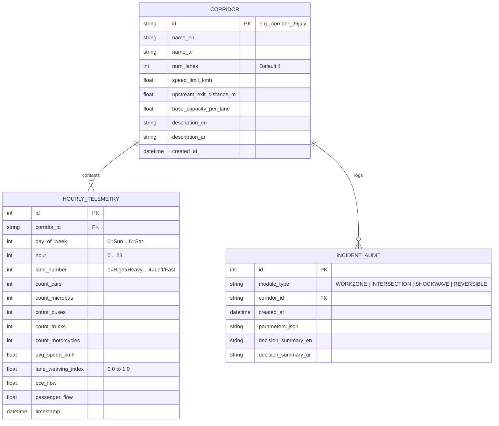
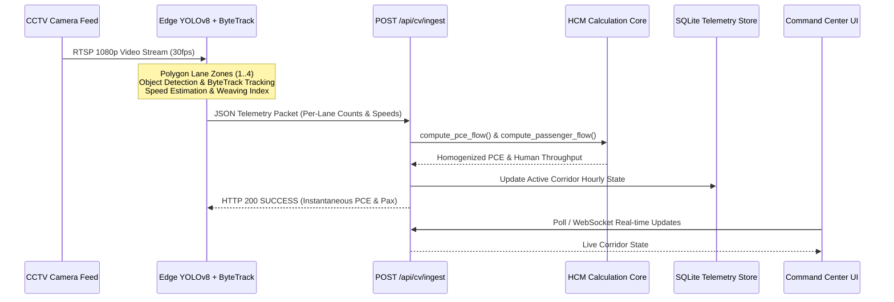

# Intelligent Traffic Decision Support System (IT-DSS)
## System Architecture Specification (`ARCHITECTURE.md`)

---

## 1. Executive Architectural Blueprint

The **Intelligent Traffic Decision Support System (IT-DSS)** is engineered as a deterministic, full-stack decision intelligence platform for highway and urban traffic management authorities (e.g., traffic police operations rooms, transport ministries, corridor command centers).

The architecture is designed around four core tenets:
1. **Mathematical Determinism:** Direct execution of Highway Capacity Manual (HCM), Webster delay, and LWR shockwave physics rather than black-box mockups.
2. **Modular Monorepo Structure:** Clean decoupling between data ingestion, numerical physics engines, FastAPI web services, and React 18 / TypeScript operations dashboards.
3. **Self-Contained Persistence:** Zero-config SQLite database via SQLModel ORM pre-seeded on startup with 2,016 realistic Egyptian corridor telemetry records.
4. **Bilingual Executive Readiness:** Dynamic LTR/RTL layout switching between English and Egyptian/Standard Arabic without third-party runtime bloat.

```mermaid
graph TD
    subgraph Data & Telemetry Ingestion Layer
        Seeder[Synthetic Telemetry Generator\n3 Corridors x 4 Lanes x 7d x 24h\n2,016 Baseline Telemetry Records]
        EdgeCV[YOLOv8/v11 + ByteTrack Camera Nodes\nPOST /api/cv/ingest]
        SQLiteDB[(SQLite Database\ntraffic_dss.db\nSQLModel ORM)]
        Seeder -->|Lifespan Startup Seeding| SQLiteDB
        EdgeCV -->|Instantaneous Telemetry Updates| SQLiteDB
    end

    subgraph Mathematical Physics Engine Tier (backend/app/core/)
        HCM[hcm_math.py\n• PCE Flow Calculus\n• Human Occupancy Calculus\n• Capacity Drop Equations\n• MUTCD Geometry Tapers\n• LoS A-F Grading Engine]
        WZ[workzone_engine.py\n• 168h Maintenance Window Optimizer\n• Residual Queue Recursion\n• Exit Spillback Detection\n• Person-Hours of Delay (PHD)\n• Bilingual Field SOP Generator]
        INT[intersection_engine.py\n• Uncontrolled Open (32 Conflict Pts)\n• Webster Adaptive Signal (8 Conflict Pts)\n• Protected U-Turn Corridor (4 Conflict Pts)\n• Modern 3-Lane Roundabout (8 Pts)\n• Multi-Criteria Winning Recommender]
        LWR[shockwave_engine.py\n• LWR Hydrodynamic Wave Velocity\n• Upstream Exit Spillback Countdown\n• 60-Minute Queue Growth Trajectory\n• Micro-Friction Curb Remediation]
        REV[reversible_engine.py\n• Directional Split Ratio Meter\n• Dynamic 4+4 vs 5+3 Reallocation\n• 5-Node Green Wave Progression\n• VIP Pre-Arrival Queue Flush Lead Time]

        HCM --> WZ
        HCM --> INT
        HCM --> LWR
        HCM --> REV
    end

    subgraph REST Web Service Tier (FastAPI :8765)
        FastAPIApp[FastAPI Application Gateway\nbackend/app/main.py]
        Router[API Router: backend/app/api/routes.py\n8 REST Endpoints]
        SQLiteDB --> Router
        WZ --> Router
        INT --> Router
        LWR --> Router
        REV --> Router
        Router --> FastAPIApp
    end

    subgraph Operations Command Center (React 18 + Vite :5199)
        TopBar[TopCommandBar.tsx\nCorridor Selector | AR/EN Toggle | Radar Clock]
        Sidebar[SidebarNav.tsx\n4 DSS Module Switcher]
        
        M1[WorkZoneAdvisor.tsx\n• 24h Demand vs Capacity Recharts Area Profile\n• Top 3 Optimal Windows vs Worst Window\n• Printable/Copyable Field SOP Drawer]
        M2[IntersectionSimulator.tsx\n• Flow / Turning / Heavy Vehicle Sliders\n• 4-Way Side-by-Side Comparison Matrix\n• Winning Engineering Rationale Banner]
        M3[ShockwavePredictor.tsx\n• Incident Type & Blocked Lanes Selector\n• Shockwave Speed & Red Alert Countdown\n• 60-Minute Queue Growth Timeline Graph]
        M4[ReversiblePlanner.tsx\n• Inbound/Outbound Surge Sliders\n• 4+4 vs 5+3 Travel Time Savings %\n• 5-Intersection Progression Offsets Table]

        Canvas1[HighwayCanvas.tsx\n60fps HTML5 4-Lane Canvas\nClass-Coded Particles, Taper Cones, Merging & Shockwave Queues]
        Canvas2[IntersectionCanvas.tsx\nSplit-Screen 60fps Comparator\nSignal Stop-and-Go vs Protected U-Turn Continuous Flow]

        TopBar --> Sidebar
        Sidebar --> M1 & M2 & M3 & M4
        M1 --> Canvas1
        M3 --> Canvas1
        M2 --> Canvas2
    end

    FastAPIApp <-->|JSON REST APIs / Vite Proxy /api| M1 & M2 & M3 & M4
```

---

## 2. Monorepo File & Module Structure

```text
traffic-dss-platform/
├── ARCHITECTURE.md                  # System Architecture & Technical Specifications
├── ALGORITHMS.md                    # Complete Mathematical Physics & Algorithms
├── SPEC.md                          # Master Project Specifications
├── README.md                        # Project Setup, Overview & Quickstart Guide
├── docker-compose.yml               # Multi-container orchestration (Ports 8765 & 5199)
├── run_dss.bat                      # Windows one-click dual server launcher
├── backend/
│   ├── requirements.txt             # Python dependencies (FastAPI, SQLModel, NumPy, etc.)
│   ├── Dockerfile                   # Python 3.11-slim container spec (Port 8765)
│   ├── app/
│   │   ├── main.py                  # FastAPI entry point, lifespan seeder, CORS, port 8765
│   │   ├── models/
│   │   │   ├── domain.py            # SQLModel ORM entities (Corridor, HourlyTelemetry, IncidentAudit)
│   │   │   └── schemas.py           # Pydantic v2 request/response validation contracts
│   │   ├── core/
│   │   │   ├── hcm_math.py          # PCE, Occupancy, Capacity Drop, Taper, LoS
│   │   │   ├── workzone_engine.py   # Module 1: 168h Maintenance Window Optimizer & SOP
│   │   │   ├── intersection_engine.py # Module 2: 4-Way Geometric Alternative Simulator
│   │   │   ├── shockwave_engine.py  # Module 3: LWR Shockwave, Spillback & Micro-Friction
│   │   │   └── reversible_engine.py # Module 4: 5+3 Reversible Lanes & Green Wave
│   │   ├── services/
│   │   │   ├── synthetic_seeder.py  # 3 Egyptian Corridors x 4 Lanes x 7 Days x 24 Hours
│   │   │   └── cv_ingestion.py      # Edge YOLOv8/v11 + ByteTrack ingestion pipeline
│   │   ├── sumo/
│   │   │   ├── networks/            # 5 SUMO networks XML (4 intersections + 4-lane highway) & base.sumocfg
│   │   │   ├── generator.py         # Multi-class heterogeneous vehicle & route generator
│   │   │   ├── runner.py            # TraCI runtime execution & microscopic metric extractor
│   │   │   └── service.py           # Hybrid Digital Twin orchestrator & fallback
│   │   └── api/
│   │       └── routes.py            # 12 REST API endpoints (HCM + SUMO Digital Twin)
│   └── tests/
│       ├── test_engines.py          # Unit tests for all 4 mathematical engines
│       ├── test_api.py              # FastAPI TestClient integration test suite
│       └── test_sumo.py             # SUMO TraCI & microscopic simulation test suite
└── frontend/
    ├── package.json                 # React 18, Lucide React, Recharts, Tailwind CSS
    ├── vite.config.ts               # Vite configuration (Port 5199, reverse proxy to :8765)
    ├── tailwind.config.js           # Custom tactical dark-mode operations theme
    ├── Dockerfile                   # Node.js alpine container spec (Port 5199)
    └── src/
        ├── App.tsx                  # Master Command Center Shell & State Orchestrator
        ├── index.css                # Tactical dark styling, custom scrollbars, animations
        ├── i18n/
        │   └── translations.ts      # Native Arabic (RTL) & English (LTR) dictionary
        ├── api/
        │   └── client.ts            # Typed API client + embedded deterministic fallback
        ├── components/
        │   ├── layout/
        │   │   ├── TopCommandBar.tsx# Corridor switcher, AR/EN toggle, Radar clock
        │   │   └── SidebarNav.tsx   # 4 DSS Module Navigation Drawer
        │   ├── simulation/
        │   │   ├── HighwayCanvas.tsx    # 60fps HTML5 4-lane Highway micro-simulator
        │   │   └── IntersectionCanvas.tsx # Split-screen Signal vs U-Turn simulator
        │   ├── common/
        │   │   ├── KpiCard.tsx          # Operations-grade KPI badge card
        │   │   └── SopActionCard.tsx    # Printable/Copyable Standard Operating Procedure
        │   └── modules/
        │       ├── WorkZoneAdvisor.tsx     # Module 1 Operations Dashboard
        │       ├── IntersectionSimulator.tsx # Module 2 Operations Dashboard
        │       ├── ShockwavePredictor.tsx  # Module 3 Operations Dashboard
        │       └── ReversiblePlanner.tsx   # Module 4 Operations Dashboard
```

---

## 3. Data Tier & Storage Architecture

### 3.1 SQLite Persistence Model via SQLModel
Persistence is managed via SQLite (`traffic_dss.db`) using `SQLModel` (unifying SQLAlchemy ORM and Pydantic validation). This delivers zero-config, out-of-the-box local storage without external database installation, while remaining fully swappable to PostgreSQL or TimescaleDB.



### 3.2 Pre-Seeded Egyptian Arterial Corridors
On initial startup, `synthetic_seeder.py` automatically initializes and populates the database with 3 strategic Egyptian corridors:

1. **26th of July Corridor (محور ٢٦ يوليو):**
   - **Route:** Connects Lebanon Square (Giza) with Sheikh Zayed and 6th of October City.
   - **Geometry:** 4 lanes per direction, speed limit $80\text{ km/h}$, upstream exit at $600\text{ m}$.
   - **Characteristics:** Morning inbound commuter surge, afternoon outbound school/office rush, high microbus presence ($28\%$).

2. **Ring Road - Giza Sector (الطريق الدائري - قطاع الجيزة):**
   - **Route:** Orbital expressway encircling Greater Cairo across the Mariouteya / Moneeb sectors.
   - **Geometry:** 4 lanes per direction, speed limit $90\text{ km/h}$, upstream exit at $750\text{ m}$.
   - **Characteristics:** Heavy intercity freight and regional logistics ($16\%$ trucks, $32\%$ microbuses), night freight spikes.

3. **Salah Salem Axis (محور صلاح سالم):**
   - **Route:** High-density arterial linking Heliopolis, Nasr City, Downtown, and Cairo International Airport.
   - **Geometry:** 4 lanes per direction, speed limit $70\text{ km/h}$, upstream exit at $450\text{ m}$.
   - **Characteristics:** Continuous commercial flow, dense intersections, frequent informal stops.

---

## 4. Edge Computer Vision (CV) Ingestion Architecture

IT-DSS is designed with a real-time ingestion pipeline ready to receive telemetry directly from edge camera processing nodes running YOLO (v8/v11) and ByteTrack polygon zone counters.



---

## 5. Network & Port Configuration

To avoid conflicts with external services running on default development ports (e.g., 8000, 5173, 3000), IT-DSS is assigned dedicated, non-conflicting port ranges:

| Service | Protocol | Port | Description |
| :--- | :---: | :---: | :--- |
| **Backend REST API** | HTTP | **`8765`** | FastAPI / Uvicorn server (`backend/app/main.py`) |
| **Swagger Interactive Docs** | HTTP | **`8765`** | Interactive OpenAPI documentation at `/docs` |
| **Frontend Command Center** | HTTP | **`5199`** | React 18 / Vite development server (`frontend/`) |
| **Vite API Reverse Proxy** | HTTP | **`5199`** | Proxies all `/api/*` requests internally to `http://127.0.0.1:8765` |

---

## 6. Frontend Operations Command Center Architecture

### 6.1 State Management & Fallback Redundancy
The frontend features a dual-layer data architecture:
- **Online Mode:** Queries the FastAPI backend endpoints via `client.ts`.
- **Standalone Offline Fallback:** If the backend is temporarily offline or presenting in disconnected environments, `client.ts` executes identical deterministic mathematical formulas locally in TypeScript. The dashboard never crashes or displays empty states.

### 6.2 Native Bilingual Translation Engine (RTL / LTR)
The bilingual dictionary is maintained in [translations.ts](file:///d:/projects/traffic_dss/frontend/src/i18n/translations.ts). Language toggling occurs instantly without page reloads:
```typescript
const handleToggleLanguage = () => {
  const nextLang = language === 'ar' ? 'en' : 'ar';
  setLanguage(nextLang);
  document.documentElement.dir = nextLang === 'ar' ? 'rtl' : 'ltr';
  document.documentElement.lang = nextLang;
};
```
- **Arabic Mode:** Sets `dir="rtl"`, aligns labels, mirrors flex rows, renders Cairo typography.
- **English Mode:** Sets `dir="ltr"`, renders Inter typography.

### 6.3 60fps Microscopic Canvas Rendering Pipeline
Both simulation canvases ([HighwayCanvas.tsx](file:///d:/projects/traffic_dss/frontend/src/components/simulation/HighwayCanvas.tsx) and [IntersectionCanvas.tsx](file:///d:/projects/traffic_dss/frontend/src/components/simulation/IntersectionCanvas.tsx)) maintain internal 60fps `requestAnimationFrame` loops completely decoupled from React's virtual DOM reconciliation.
- **Particle System:** Maintains an in-memory array of active vehicle particles (position, velocity, lane, vehicle class, braking state).
- **Asphalt & Markings:** Rendered on HTML5 2D canvas with dashed lane dividers, jersey barriers, and warning cones.
- **Dynamic Physics Integration:** Canvas vehicle densities, speeds, and queues dynamically scale with the user's slider inputs and calculated engine results.

---

## 7. REST API Endpoints Specification

### Endpoint Inventory:

1. `GET /api/health`
   - **Description:** Verifies service health and inventories active mathematical engines.
   - **Response:**
     ```json
     {
       "status": "ONLINE",
       "service": "Intelligent Traffic Decision Support System (IT-DSS)",
       "version": "1.0.0-production",
       "engines": ["HCM-WorkZone", "Webster-Intersection", "LWR-Shockwave", "Dynamic-Reversible"]
     }
     ```

2. `GET /api/corridors`
   - **Description:** Returns all pre-seeded Egyptian arterial corridors.

3. `GET /api/corridors/{corridor_id}/telemetry?day_of_week={0-6}`
   - **Description:** Returns 24-hour hourly profile with per-lane breakdowns (PCE, human passengers, speed, weaving index).

4. `POST /api/dss/workzone-optimize`
   - **Description:** Computes capacity drop, queue accumulation, Top 3 optimal maintenance windows, worst window, and bilingual field SOP.

5. `POST /api/dss/intersection-simulate`
   - **Description:** Evaluates Uncontrolled Open vs. Webster Signal vs. Protected U-Turn vs. Roundabout.

6. `POST /api/dss/shockwave-predict`
   - **Description:** Calculates LWR backward shockwave speed, countdown to upstream exit blockage, and 60-min queue expansion trajectory.

7. `POST /api/dss/reversible-evaluate`
   - **Description:** Evaluates directional split, 4+4 vs 5+3 reversible reallocation, and configurable-node Green Wave offsets at 450 m spacing.

8. `POST /api/cv/ingest`
   - **Description:** Ingests live edge YOLO + ByteTrack counts and updates active corridor state.

9. `GET /api/dss/sumo/status`
   - **Description:** Reports native SUMO/TraCI availability, binary paths, `SUMO_HOME`, and generated network files.

10. `POST /api/dss/sumo/workzone-simulate`
    - **Description:** Runs a microscopic highway bottleneck simulation using the selected day/hour's seeded telemetry demand (peak hour by default).

11. `POST /api/dss/sumo/intersection-simulate`
    - **Description:** Forces SUMO/TraCI execution across all four intersection alternatives.

12. `POST /api/dss/sumo/launch-gui?scenario={intersection|workzone}&alt_id={OPEN|SIGNAL|UTURN|ROUNDABOUT}`
    - **Description:** Launches the native desktop SUMO-GUI for live visual inspection of a scenario.
